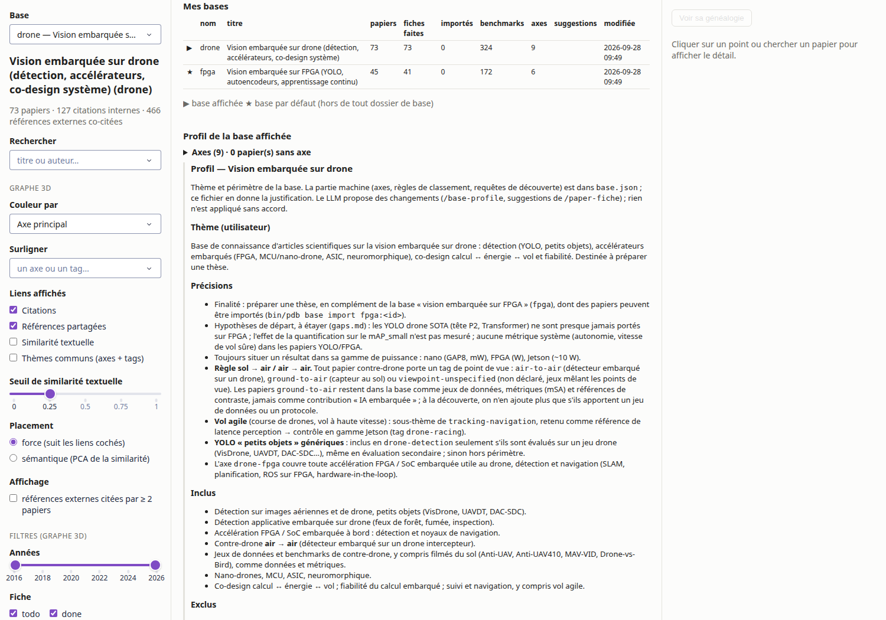
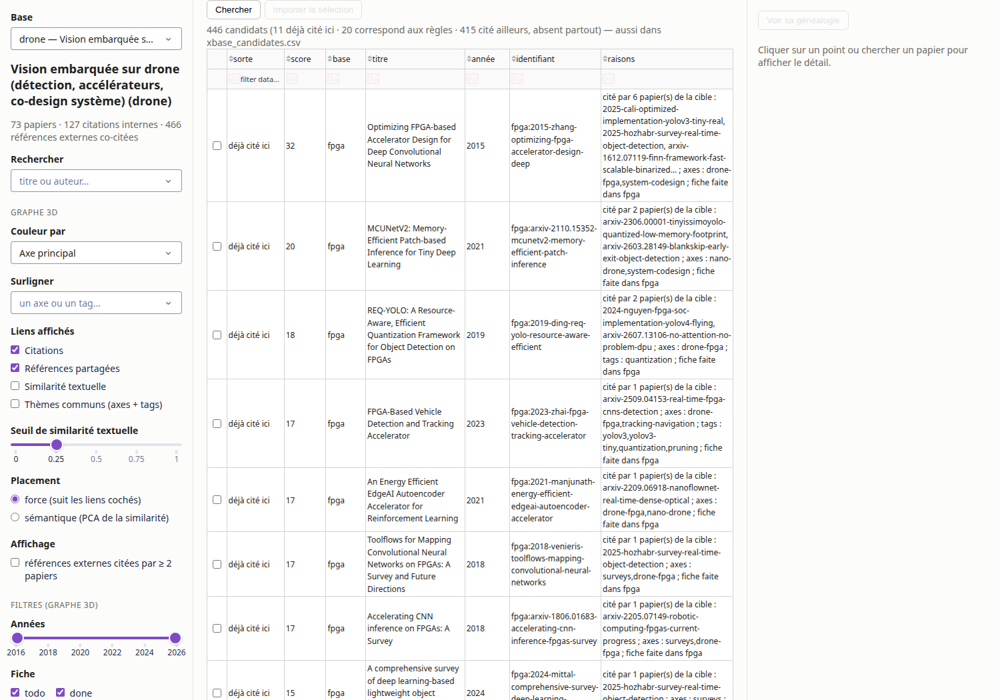

# PaperDatabase

Transforme des PDF d'articles scientifiques en une **base de connaissance textuelle,
structurée et reliée**, qu'un LLM (ici Claude Code) peut parcourir avec `grep` et `read`
sans jamais rouvrir un PDF.

L'outil n'est lié à aucun domaine : il traite n'importe quel corpus d'articles scientifiques,
et **un même code gère plusieurs bases de connaissance séparées**, une par sujet, utilisables
en parallèle ([Plusieurs bases de connaissance](#plusieurs-bases-de-connaissance)). Le dépôt en
contient trois : deux servent à préparer une thèse, la troisième rassemble les références d'un stage :

| Base | Intitulé | Dossier |
|---|---|---|
| `fpga` | Vision embarquée sur FPGA (YOLO, autoencodeurs, apprentissage continu) ; thèse « IA embarquée sécuritaire certifiable sur FPGA » | [`bases/fpga/`](bases/fpga/) |
| `drone` | Vision embarquée sur drone (détection, accélérateurs, co-design système) | [`bases/drone/`](bases/drone/) |
| `stage` | Apprentissage continu embarqué pour la maintenance prédictive (stage ISAE) | [`bases/stage/`](bases/stage/) |

---

## Pourquoi

Dans un projet de recherche, un LLM travaille mal sur des PDF bruts. Il perd du contexte à
les relire, ne sait pas où chercher un chiffre et confond vite ce que dit un article avec ce
qu'il en déduit.

PaperDatabase convertit chaque article en fichiers texte : sections numérotées et paginées,
métadonnées vérifiées, références extraites, fiche de lecture et chiffres rangés dans un CSV.
Ces fichiers s'organisent en couches, du résumé au texte intégral. L'agent lit la couche la
plus haute qui répond à sa question et ne descend que si nécessaire.

Il n'y a pas de base de données. La source de vérité est une arborescence de fichiers texte
bien nommés et greppables, lisible, diffable et réparable à la main. Un index de passages
local (BM25 + embeddings, dans `.cache/`, régénérable) s'ajoute par-dessus pour la recherche
par le sens, sans rien changer aux fichiers.

---

## 1. Traitement des PDF

```
arXiv id / URL ──► bin/add.py ──► inbox/ ──► bin/ingest.py ──► papers/<paper_id>/
DOI ──► OpenAlex ──► version arXiv ─┘              │
PDF local (+ .bib/.ris) ──────────► inbox/        ├─ GROBID (Docker) : structure, métadonnées, références
                                                  ├─ PyMuPDF : tableaux réduits à leur légende
                                                  └─ repli PyMuPDF si GROBID est indisponible
```

- **`add.py`** récupère un article arXiv (métadonnées via l'API, puis le PDF), résout un DOI
  vers sa version arXiv via OpenAlex, ou copie un PDF local dans `inbox/`, puis lance
  l'ingestion. `--from liste.txt` traite un lot.
- **`ingest.py`** passe chaque PDF de `inbox/` dans GROBID :
  - il fusionne les métadonnées (export de citation `.bib` / `.ris` déposé à côté, puis
    arXiv, puis GROBID ; un champ inconnu reste `null`) ;
  - il nettoie le corps (en-têtes, numéros de page, bibliographie), répare les ligatures
    perdues (« classi cation ») et rend au corps les paragraphes que GROBID prenait pour
    des figures ;
  - il garde les légendes et le contenu des tableaux, qui portent souvent les chiffres ;
    quand GROBID n'a gardé que la légende, il tente de reconstruire le tableau depuis le
    PDF (PyMuPDF, puis Docling avec `--reparse --tables docling [--ocr]`), marqué « à
    vérifier », sinon il le signale ;
  - il écrit les fichiers ci-dessous.

  Il est idempotent, et `--force` réextrait sans jamais écraser une fiche déjà rédigée.
  `--reparse` ré-extrait tout le corpus depuis les TEI conservés, sans GROBID, après une
  amélioration du parsing.
- Les articles sous paywall se déposent **à la main** dans `inbox/`. L'outil ne contourne
  aucun paywall.

Chaque article devient un dossier `papers/<paper_id>/` :

| Fichier | Contenu |
|---|---|
| `metadata.json` | titre, auteurs, année, venue, DOI/arXiv, type (preprint signalé), axes, tags, statut |
| `fulltext.md` | texte intégral nettoyé, sections `##` / `###` avec leur numérotation d'origine |
| `sections.jsonl` | une ligne par section avec son type (abstract, section, figure, table) et sa **page** |
| `refs.jsonl` | références citées : titre, auteurs, année, DOI, arXiv id |
| `fiche.md` | fiche de lecture : problème, méthode, résultats, limites, pertinence, lu vs déduit |
| `paper.pdf`, `grobid.tei.xml` | preuve et trace d'extraction, non versionnés |
| `docling_tables.json` | tableaux lus par Docling, s'il a été lancé (trace, relue par `--reparse`) |

---

## 2. Base de connaissance et navigation par un LLM

L'agent lit **du résumé vers le détail** et s'arrête dès qu'il a la réponse :

| Couche | Fichier | Sert à |
|---|---|---|
| 1 | `INDEX.md` | savoir quels articles existent, par axe, fichés ou non (généré par `reindex.py`) |
| 2 | `benchmarks.csv` | trouver tous les chiffres, une ligne par configuration rapportée, avec section source et niveau de confiance |
| 3 | `papers/<id>/fiche.md` | lire l'analyse critique d'un article |
| 4 | passages (`bin/pdb search`, `show`, `verify`) | trouver les 2-3 passages qui répondent, les lire en texte exact, vérifier chaque citation |
| — | `fulltext.md` | texte intégral, en dernier recours seulement |
| 5 | `gaps.md` | consulter les zones non couvertes par le corpus, chacune appuyée par des `paper_id` |
| — | `external_refs.csv` | repérer les travaux absents de la base les plus cités par le corpus (généré par `reindex.py`) : les prochaines lectures |

**Requêtes sans LLM** (`bin/pdb`, bibliothèque standard ou index local ; sortie compacte,
colonnes de source toujours affichées) :

| Commande | Effet |
|---|---|
| `bin/pdb bench [filtres]` | filtre `benchmarks.csv` (plateforme, colonne renseignée, tri, `--count`) ; `--check` : chaque valeur est-elle dans son passage cité (`chunk_id`) ? |
| `bin/pdb paper <id \| mot>` | fiche d'identité d'un papier : métadonnées, preprint, statut de fiche, benchmarks |
| `bin/pdb search "<question>"` | passages classés (BM25 + embeddings bge-small, fusion RRF, `--rerank` en option), avec `chunk_id`, section et page ; modèles Qwen sur GPU si la route GPU est active (`bin/pdb gpu`) |
| `bin/pdb show <chunk_id>` / `verify <chunk_id> "<citation>"` | texte exact d'un passage / contrôle qu'une citation y figure, nombres compris (`NOMBRES` si un chiffre diffère) |
| `bin/pdb cites <id>` / `cited-by <id>` | graphe de citations internes, références hors base (`--external`) |

Sur un essai réel (répondre à une question sur la mesure de puissance), cette chaîne a lu
~2 500 tokens au lieu des textes intégraux.

**Performances mesurées** par le banc `bin/pdb eval` ([docs/EVAL.md](docs/EVAL.md)) :
- recherche : recall@5 de 0,90 en anglais sur le jeu qui a servi aux réglages, 0,84 sur un
  jeu de questions jamais utilisé pour régler, et 0,50 en français ;
- `verify` rejette les 38 citations dont un chiffre a été modifié et accepte les 40
  citations exactes ;
- extraction : 91 % du texte du PDF retrouvé et 90 % des tableaux avec leur corps.

Limite connue : `search` renvoie toujours des passages, et aucun score ne dit de façon fiable
que la base ne traite pas une question.

**Liens entre articles :**

- des axes de veille (valeurs fermées) et des tags (modèles, plateformes, toolflows) ;
- les références extraites, qui permettent de repérer les citations internes au corpus ;
- les clés `paper_id` partagées entre `benchmarks.csv`, les fiches, `INDEX.md` et `gaps.md`.

**Mode d'emploi de l'agent :** [CLAUDE.md](CLAUDE.md) donne l'ordre de lecture et les règles
de travail : ne jamais inventer de référence, écrire `n/r` pour une valeur non rapportée,
distinguer le lu du déduit, relever les comparaisons biaisées. Cinq commandes Claude Code
(`.claude/commands/`) automatisent le travail :

| Commande | Effet |
|---|---|
| `/paper-add <arxiv-id \| url \| doi \| chemin.pdf>` | acquisition, ingestion et réindexation |
| `/paper-fiche <paper_id>` | remplit la fiche et ajoute les lignes de `benchmarks.csv`, chaque chiffre avec sa section source |
| `/paper-ask <question>` | réponse sourcée : `bench`, puis `search`, `show`, `verify` ; chaque citation vérifiée |
| `/paper-discover [axe \| gap \| mots-clés]` | candidats via OpenAlex (citations du corpus, recherche), liste courte, ajout après accord |
| `/paper-gaps` | met à jour `gaps.md` depuis les fiches terminées et les benchmarks |

---

## Principes

- **Tout est du texte**, à part le PDF d'origine conservé comme preuve.
- **Chaque chiffre est traçable** : il porte sa section, son tableau ou sa figure source.
  Une valeur non rapportée s'écrit `n/r`, jamais une estimation.
- **Le lu et le déduit sont séparés** : chaque fiche a une section « Statut de lecture »
  obligatoire.
- **Un seul endroit code le schéma** : `lib/schema.py`, validé par `reindex.py`.

---

## Démarrage rapide

Prérequis : Python 3.12, Docker. **Guide d'utilisation pas à pas : [docs/GUIDE.md](docs/GUIDE.md).**
Présentation sous forme d'article (principes, RAG, tests, évaluation) :
[docs/article/](docs/article/), à compiler avec `make -C docs/article`.

```bash
bash bin/setup.sh              # crée .venv, installe requirements.txt
bin/pdb grobid start           # GROBID sur localhost:8070
bin/pdb status                 # état de la base et prochaines actions
bin/pdb add 2507.18174         # un article arXiv (ou un DOI, un PDF local, --from liste.txt)
bin/pdb discover               # papiers candidats à l'ajout (OpenAlex) → candidates.csv
```

Ces commandes agissent sur la base du dossier courant : `fpga` dans `bases/fpga/`, `drone`
dans `bases/drone/`, `stage` dans `bases/stage/` (à la racine du dépôt : la base par défaut du registre) ([Plusieurs bases de connaissance](#plusieurs-bases-de-connaissance)).
`add` et `ingest` réindexent d'eux-mêmes (`INDEX.md`, `external_refs.csv`). Ensuite, dans
Claude Code : `/paper-fiche <paper_id>` produit la fiche de lecture, `/paper-discover`
propose des papiers à ajouter, `/paper-gaps` met à jour la carte des gaps. Le détail de
chaque script est dans [SETUP.md](SETUP.md).

---

## Plusieurs bases de connaissance

Une base est un dossier qui contient son thème et ses articles :
- `base.json` : axes et règles de classement ;
- `profile.md` : thème et périmètre, en texte ;
- `papers/`, `benchmarks.csv`, `gaps.md`, `INDEX.md`.

Le code (`bin/`, `lib/`, `.venv`, les skills de `.claude/commands/`) est commun à toutes les
bases. Un registre (`~/.config/pdb/bases.json`) donne à chaque base un nom court. Les bases
sont indépendantes : chacune a ses fiches, ses chiffres, sa carte des gaps et son index de
passages. Un article peut toutefois être copié de l'une à l'autre. Détails :
[DATA_MODEL.md §11](DATA_MODEL.md#11-plusieurs-bases--registre-basejson-profilemd).

### Les bases actuelles

Au 29/09/2026 :

| Base | Intitulé | Dossier | Papiers | Fiches faites | Lignes de benchmark |
|---|---|---|---|---|---|
| `fpga` (par défaut) | Vision embarquée sur FPGA (YOLO, autoencodeurs, apprentissage continu, sûreté et certification) | `bases/fpga/` | 101 | 101 | 299 |
| `drone` | Vision embarquée sur drone (détection, accélérateurs, co-design système) | `bases/drone/` | 73 | 73 | 324 |
| `stage` | Apprentissage continu embarqué pour la maintenance prédictive (stage ISAE) | `bases/stage/` | 56 | 56 | 100 |

La base `drone` s'appelait auparavant `DroneVisionDB` et vivait dans un dossier séparé. Chaque
base a son `CLAUDE.md` (règles propres au domaine), son [`profile.md`](bases/drone/profile.md)
et sa carte des gaps : [bases/fpga/gaps.md](bases/fpga/gaps.md) pour `fpga`, [bases/drone/gaps.md](bases/drone/gaps.md)
pour `drone`, [bases/stage/gaps.md](bases/stage/gaps.md) pour `stage`.

### Travailler sur plusieurs bases en parallèle

La base active est celle du dossier courant (hors de tout dossier de base, par exemple à la
racine du dépôt : la base par défaut du registre). Toutes les commandes et les skills agissent sur
cette base seulement.

```bash
bin/pdb base list                  # bases enregistrées, effectifs ; * = défaut, > = active
cd bases/drone && bin/pdb status   # travailler dans la base drone
bin/pdb --base drone bench -h      # viser une base depuis n'importe quel dossier
bin/pdb base use drone             # base par défaut hors de tout dossier de base
```

- **Deux sessions Claude Code en même temps.** Ouvrez-en une dans `bases/fpga/` (base `fpga`) et une
  dans `bases/drone/` (base `drone`). Chacune lit son propre `CLAUDE.md`, et `/paper-fiche`,
  `/paper-ask`, `/paper-gaps` n'y voient que leur base.
- **Rien n'est partagé par accident.** Index de passages, caches OpenAlex et candidats sont
  propres à chaque base (dans son `.cache/`).
- **L'interface** permet de passer d'une base à l'autre sans quitter l'application (voir
  [Visualisation](#visualisation-outil-secondaire)).

### Créer une base

```bash
bin/pdb base new anomalies --theme "Détection d'anomalies visuelles embarquée, par autoencodeurs…"
cd bases/anomalies                 # puis, dans Claude Code : /base-profile
```

`base new` crée le dossier `bases/<nom>/`, versionné avec le dépôt : liens vers le code,
`profile.md`, `CLAUDE.md` générique et `benchmarks.csv` vide. Il enregistre aussi la base.
`/base-profile` tire du thème des axes, des règles de classement et un périmètre (inclus,
exclus), puis les affine au fil des lectures. Le LLM **propose un diff, et vous validez** :
rien n'est écrit sans votre accord. `/paper-fiche` note au passage des « suggestions en
attente » dans `profile.md` : sous-thème émergent, papier hors de tous les axes.

### Compléter une base depuis les autres

```bash
bin/pdb base scan --from fpga      # dans bases/drone : articles utiles de la base fpga
bin/pdb base import fpga:<paper_id>
```

`scan` classe trois sortes de candidats :
- les articles d'une autre base que cette base **cite déjà** sans les avoir ;
- ceux qui correspondent à ses règles de classement ;
- les références citées à la fois ici et là-bas, absentes des deux bases.

`import` copie un article sans refaire l'extraction. Ses axes sont recalculés pour la base qui
le reçoit, et sa fiche repasse à `todo`, avec un bandeau « pertinence à réévaluer ».
`bin/pdb add` refuse un article déjà présent dans une autre base et donne la commande d'import.
`/paper-discover` parcourt les autres bases avant d'interroger OpenAlex.

### Nouveau clone

Le registre est local. Après un clone, enregistrez les bases une fois :

```bash
bin/pdb base register bases/fpga --name fpga
bin/pdb base register bases/drone --name drone
bin/pdb base register bases/stage --name stage
```

---

## Route GPU optionnelle et benchmark synthétique

Par défaut, la recherche de passages tourne sur CPU (`pdb search`, `/paper-ask`). Si vous voulez utiliser votre carte graphique et qu'elle est CUDA, la route GPU (contribution de Maksym Lytvynenko) s'active avec `.venv/bin/pip install -r requirements-rag.txt` puis `bin/pdb gpu on` : `pdb search` et `/paper-ask` passent alors sur Qwen3-Embedding-4B et Qwen3-Reranker-4B, avec les mêmes `chunk_id`, `show` et `verify`. Elle donne aussi accès à `bin/pdb rag` (index de preuves, acquisition de PDF en libre accès, importés après accord) et à `/paper-research`. Sans GPU, rien ne change et rien n'échoue ([docs/RAG.md §13](docs/RAG.md#13-route-gpu-optionnelle-qwen3)).

`bin/pdb synth` construit un benchmark synthétique sur un corpus isolé de 200 articles (questions générées localement, validées par deux sessions indépendantes ; validation, agents et juge passent par Claude Code en mode non interactif) : [docs/BENCHMARK.md](docs/BENCHMARK.md), [SETUP.md §10](SETUP.md).

---

## Adapter à un autre sujet de recherche

Un nouveau sujet, c'est une nouvelle base : voir [Créer une base](#créer-une-base). Les
colonnes de `benchmarks.csv` (`BENCHMARK_COLUMNS` dans `lib/schema.py`) et le template de
fiche restent communs à toutes les bases.

---

## Visualisation (outil secondaire)

Cet outil est une vue d'ensemble destinée à l'utilisateur. **Le LLM ne s'en sert pas.**

`bin/viz.py` est une application web locale écrite avec Plotly et Dash. Elle a trois onglets
(Graphe 3D, Généalogie, Bases) et, en haut à gauche, un **sélecteur de base** : tous les
onglets affichent la base choisie, sans relancer l'application.

```bash
.venv/bin/pip install -r requirements-viz.txt   # une fois : dépendances séparées, optionnelles
bin/pdb viz                                     # http://127.0.0.1:8050 (--port N pour un autre port)
bin/pdb --base drone viz                        # ouvrir directement sur la base drone
```

**Graphe 3D** — le corpus en nuage de points :

- la couleur donne le thème (axe, tag, année, type ou statut de fiche) ;
- les liens montrent les citations, les références partagées, la similarité textuelle
  (TF-IDF, ou embeddings si `requirements-embed.txt` est installé) ou les thèmes communs ;
- le placement est soit force-directed, soit sémantique ;
- recherche par titre ou auteur, filtres par année, statut de fiche et type ;
- un clic affiche la fiche de lecture et les lignes de `benchmarks.csv` du papier ;
- en option, les travaux cités par plusieurs articles mais absents de la base apparaissent,
  comme candidats à l'ajout.

**Généalogie** — l'historique d'un sujet ou d'un papier sur une frise chronologique, le long
des citations : ce qu'il cite, ce qui le cite, et, en option, les « suites probables »
déduites de la similarité textuelle (signalées comme inférées).

**Bases** — la gestion des bases, sans ligne de commande :

- tableau de toutes les bases enregistrées : papiers, fiches faites, articles importés,
  lignes de benchmark, axes, suggestions de profil en attente ;
- profil de la base affichée (`profile.md`), avec ses axes et ses effectifs. Les suggestions
  en attente sont mises en évidence et se valident avec `/base-profile` : l'interface ne
  modifie jamais le profil ;
- **Compléter depuis mes autres bases** : choix des bases à parcourir, tableau des candidats
  (triable, filtrable, avec les raisons), puis **Importer la sélection**. Les références
  absentes de toutes les bases affichent la commande `/paper-add` à lancer ;
- **Nouvelle base** : nom, intitulé, dossier et thème, comme `bin/pdb base new`.





Les onglets Graphe 3D et Généalogie sont en lecture seule. L'onglet Bases n'écrit que sur
action explicite : « Créer la base » et « Importer la sélection ».

Détails et limites : [SETUP.md §5](SETUP.md#binvizpy---port-8050---debug).

---

## Arborescence

```
PaperDatabase/                # le code seul ; les données sont dans bases/
├── README.md  CLAUDE.md  SETUP.md  DATA_MODEL.md
├── bases/
│   ├── fpga/                 # base fpga (référence) :
│   │   ├── CLAUDE.md  base.json  profile.md   # mode d'emploi, axes et règles, thème
│   │   ├── INDEX.md  external_refs.csv        # générés
│   │   ├── benchmarks.csv  gaps.md  labs.md  basicStart.txt
│   │   ├── papers/<paper_id>/                 # un dossier par article
│   │   ├── inbox/  figures/  eval/results/    # PDF à ingérer, pdb plot, runs de pdb eval
│   │   ├── eval/answers/<run>/                # réponses enregistrées par /eval-answers, grades.csv
│   │   ├── docs/experiences/                  # protocoles des mesures propres
│   │   └── bin  .venv  .claude/commands       # liens vers le code (racine)
│   ├── drone/                # base drone : même structure
│   └── stage/                # base stage (références du stage) : même structure
├── templates/                # CLAUDE.md et profile.md d'une nouvelle base (pdb base new)
├── docs/                     # GUIDE.md (utilisation), RAG.md (recherche), EVAL.md (banc),
│                             # images/ (captures de l'interface), article/, research/
├── eval/                     # seuils par défaut du banc (pdb eval)
├── bin/                      # pdb (point d'entrée), setup.sh, grobid.sh, add.py, ingest.py,
│                             # reindex.py, discover.py, bases.py (pdb base), viz.py
├── lib/                      # ids, tei, doc, pdftext, ligatures, tables, schema, refs, query, rag,
│                             # openalex, citation, status, evaluation, docling_tables…
│                             # base, registry, bases, xbase, vizbases (plusieurs bases)
├── tests/
└── .claude/commands/         # /paper-add, /paper-fiche, /paper-gaps, /paper-discover,
                              # /paper-ask, /paper-research, /base-profile, /eval-answers
```

---

## État et documentation

Au 01/10/2026, le dépôt contient trois bases (voir [Les bases actuelles](#les-bases-actuelles)) :
- `fpga` : vision embarquée sur FPGA, Jetson, VPU, Edge TPU, Hailo et MCU, orientée vers la
  thèse « IA embarquée sécuritaire certifiable sur FPGA » (axes `safety-certification` et
  `person-detection`). 101 articles, tous fichés ; 299 lignes dans `benchmarks.csv` (216 sur
  FPGA) ; 36 gaps dans [bases/fpga/gaps.md](bases/fpga/gaps.md), dont 29 étayés (8ᵉ passage,
  avec sections sûreté et détection de personnes). Un état de l'art LaTeX (sources et PDF, avec trois glossaires : plateformes, modèles, métriques) est dans
  [bases/fpga/docs/etat-de-l-art/](bases/fpga/docs/etat-de-l-art/).
- `drone` : 73 articles, tous fichés ; 324 lignes dans `benchmarks.csv` ; 19 gaps dans
  [bases/drone/gaps.md](bases/drone/gaps.md), dont 17 étayés. Les 24 derniers articles ont
  été ajoutés par dépôt manuel des PDF dans `inbox/`, avec leur export de citation.
- `stage` : références d'un stage (apprentissage continu embarqué sur MCU, maintenance
  prédictive). 56 articles, tous fichés (33 par arXiv, 22 PDF locaux, en accès libre ou
  déposés à la main, 1 importé de `fpga`) ; 100 lignes dans `benchmarks.csv` ; 15 gaps dans
  [bases/stage/gaps.md](bases/stage/gaps.md), dont 12 étayés. Les références sans version
  téléchargeable automatiquement restantes sont à déposer à la main (liste dans [SETUP.md §9](SETUP.md#9-état-actuel-et-tâches-à-faire)).

### Ce qui marche (testé : 218 tests unitaires, banc `pdb eval`, essais sur les vraies bases)

- acquisition arXiv, DOI (via OpenAlex), PDF local, par lot ; exports `.bib` / `.ris`
  éditeur prioritaires sur l'en-tête GROBID (vérifié sur 6 exports IEEE, ACM, MDPI,
  Springer) ;
- extraction GROBID avec repli PyMuPDF, nettoyage d'en-tête, ligatures, hiérarchie des
  titres, ré-extraction sans GROBID ; axes, tags et avertissements manuels conservés ;
- requêtes sans LLM (`bench`, `paper`, `search`, `show`, `verify`, `cites`) et skill
  `/paper-ask`, essayée en réel ;
- découverte de candidats OpenAlex, `external_refs.csv`, `pdb status` avec prochaines
  actions ;
- tableaux réduits à leur légende : reconstruction PyMuPDF des tableaux à filets, puis
  Docling en option, avec OCR pour les tableaux en image (passé sur les deux bases : 224
  tableaux reconstruits, marqués « à vérifier » ; 0,87 et 0,90 des tableaux ont un corps) ;
- banc d'évaluation `bin/pdb eval` : qualité d'extraction, recherche, `verify`, temps ;
  comparaison entre deux runs et seuils, avec un jeu de questions et des runs propres à chaque
  base ([docs/EVAL.md](docs/EVAL.md), §9) ; réponses finales de `/paper-ask` notées sans LLM
  (`pdb eval --answers`, skill `/eval-answers`, EVAL.md §10), premier run sur fpga : hors
  corpus reconnu 6/6, verdict juste 0,83 (dev) et 0,92 (holdout) ;
- plusieurs bases séparées : registre, `pdb --base`, `pdb base new|scan|import`, profil
  thématique affiné par `/base-profile` sous validation de l'utilisateur, onglet Bases de
  l'interface.

### Ce qui manque encore

- **Tableaux** : les 44 tableaux reconstruits sont à relire contre le PDF (colonnes décalées
  ou perdues, fragments d'OCR), et 12 restent sans corps. Les valeurs de `benchmarks.csv`
  ne sont retrouvées telles quelles dans leur tableau que dans 80 % des cas.
- **Recherche** : les questions sur tableaux échouent encore, et l'absence de sujet n'est
  pas détectée ([docs/EVAL.md](docs/EVAL.md) §6).
- **Généricité** : axes et règles de classement sont propres à chaque base (`base.json`),
  mais les colonnes de `benchmarks.csv` restent communes (pensées pour le matériel : une base
  algorithmique en laisse beaucoup à n/r, et `pdb plot` ignore alors les figures vides).
- **Économie de tokens** : `/paper-fiche` lit encore `fulltext.md` en entier ; un digest
  déterministe et une pré-extraction des nombres sont prévus.
- **Traçabilité automatique** : lier chaque ligne de `benchmarks.csv` à un `chunk_id` et
  vérifier que la valeur y figure.
- **Découverte** : score sémantique des candidats et mémoire des rejets ; références
  consolidées via OpenAlex (10 citations internes seulement aujourd'hui).

Détail et ordre proposé : [SETUP.md §9](SETUP.md#9-état-actuel-et-tâches-à-faire).

S'y ajoutent, dans la base fpga, une liste de labos ([labs.md](bases/fpga/labs.md)) et un
protocole d'expérience ([docs/experiences/](bases/fpga/docs/experiences/)). L'avancement et les tâches à faire sont dans
[SETUP.md §9](SETUP.md#9-état-actuel-et-tâches-à-faire).

| Document | Contenu |
|---|---|
| [docs/GUIDE.md](docs/GUIDE.md) | guide d'utilisation : prise en main, routine, extension du corpus, dépannage |
| [SETUP.md](SETUP.md) | installation, rôle de chaque script, flux de travail, vérification, tâches |
| [docs/RAG.md](docs/RAG.md) | requêtes sans LLM et recherche de passages : spécification, évaluation, essai réel |
| [docs/EVAL.md](docs/EVAL.md) | banc d'évaluation du logiciel (`pdb eval`) : protocole, résultats de référence, corrections mesurées |
| [DATA_MODEL.md](DATA_MODEL.md) | schémas : `paper_id`, `metadata.json`, `sections.jsonl`, `refs.jsonl`, `benchmarks.csv`, fiche |
| [CLAUDE.md](CLAUDE.md), [bases/fpga/CLAUDE.md](bases/fpga/CLAUDE.md), [bases/drone/CLAUDE.md](bases/drone/CLAUDE.md), [bases/stage/CLAUDE.md](bases/stage/CLAUDE.md) | pour l'agent : dépôt du code ; mode d'emploi et règles de travail de chaque base |
| [bases/fpga/INDEX.md](bases/fpga/INDEX.md), [bases/drone/INDEX.md](bases/drone/INDEX.md), [bases/stage/INDEX.md](bases/stage/INDEX.md) | index des articles, par base |
| [bases/fpga/gaps.md](bases/fpga/gaps.md), [bases/drone/gaps.md](bases/drone/gaps.md), [bases/stage/gaps.md](bases/stage/gaps.md) | cartes des gaps, par base |
| [bases/fpga/profile.md](bases/fpga/profile.md), [bases/drone/profile.md](bases/drone/profile.md), [bases/stage/profile.md](bases/stage/profile.md) | thème et périmètre de chaque base |
