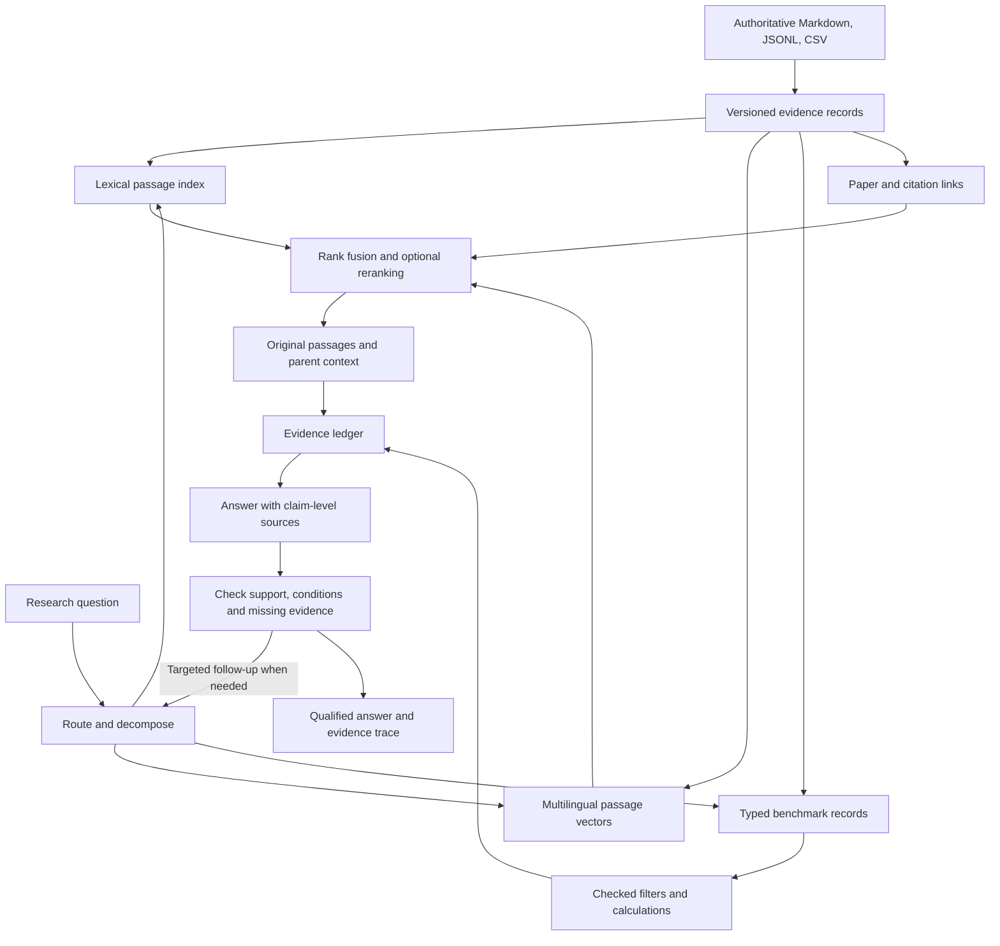

# RAG for PaperDatabase: literature review and proposed architecture

Research date: **25 September 2026**. Inspected checkout: Git commit `97a822d`, initially clean. Scope: the current PaperDatabase checkout and primary literature on scientific retrieval, grounded synthesis, structured numerical reasoning, graph retrieval, and multimodal documents.

This is a research and design report. No RAG implementation or model benchmark was performed. Corpus counts below were measured locally; performance claims belong to the cited studies. Proposed parameters and priorities are engineering judgments to validate on this repository. Deployment is provisionally local-first, with an interchangeable answer-generation backend.

## 1. Recommendation and purpose

Add an **evidence-preserving retrieval and answering layer** over the existing Markdown, JSONL, and CSV files. Keep those files authoritative and make every search index rebuildable. The first implementation should combine lexical and multilingual semantic passage retrieval, structured benchmark queries, source-linked answers, and explicit handling of missing evidence. Add citation expansion and iterative retrieval when evaluations show that they help.

The intended improvement is the ability to ask research questions such as:

- Which FPGA studies report genuinely comparable detection accuracy, throughput, and board power?
- Which papers describe continual learning without full backpropagation, even if their terminology differs?
- Which experimental conditions explain an apparent disagreement between two papers?
- What evidence supports a proposed thesis gap, and what has only failed to appear in this corpus?

Today, an assistant can already retrieve files with grep/read and generate answers. That is a manually orchestrated form of retrieval augmentation. The missing capabilities are systematic ranking, cross-language matching, measurable evidence coverage, reliable numerical joins, and reproducible source attribution.

The closest scientific architectural references are **OpenScholar** and **PaperQA2**. Both make evidence gathering a central part of answering; their large-corpus results do not establish how much PaperDatabase will improve. Borrow their retrieval, feedback, and attribution ideas while keeping the local system small. [OpenScholar, Nature 2026](https://www.nature.com/articles/s41586-025-10072-4); [PaperQA2, 2024 preprint](https://arxiv.org/html/2409.13740v2).

## 2. What the current system gives us

The existing architecture is well suited to an incremental addition. It has stable paper IDs, structured sections, curated reading notes, numerical configurations, citation metadata, and explicit conventions for unknown values. Its main strength is that a human can inspect and repair its source files.

| Observed asset or behavior | Consequence for RAG |
|---|---|
| 28 papers; 24 completed reading notes | Small enough to inspect failures manually and compare against whole-paper answering |
| 1,340 structured records: 27 abstracts, 851 sections, 314 figures, 148 tables | Index every useful source kind, with different treatment of prose and tables |
| 305,019 whitespace-separated words in extracted records | Corpus size is manageable for local indexing; this is not a model token count |
| Median record 145 words; 179 records exceed 512 words; longest 1,248 words | Token-aware splitting is needed; existing extraction blocks are not necessarily retrieval chunks |
| 109 benchmark configurations from 15 papers | Numerical questions have an existing structured foundation, but benchmark coverage is not all-paper coverage |
| French notes and largely English extracted papers | Cross-language retrieval needs explicit testing |
| 319 external works cited by at least two corpus papers | Useful discovery candidates; bibliographic metadata alone is not full-text evidence |
| Original PDFs absent from this checkout | Visual/table recovery cannot yet run against original pages here |

The current graph uses only abstract and section text: [lib/graph.py:30](/run/media/l1tw1n/E/PaperDatabase/lib/graph.py:30). Consequently, its embedding input excludes all 148 table and 314 figure records. Some figure records contain misclassified body text, so filtering them can lose more than captions.

The optional embedding implementation independently embeds roughly 200-word pieces, averages their normalized vectors, and produces **one vector per paper**. That is useful for document similarity but cannot identify the exact passage supporting a scientific claim. Keep it for visualization; build a separate passage index. [lib/embed.py:48](/run/media/l1tw1n/E/PaperDatabase/lib/embed.py:48).

The extraction layer uses a roughly 6,000-character section limit, with paragraph-aware splitting and special treatment of figures/tables. Its sequential section IDs can change after re-extraction, and a stored page is not a verified bounding box or complete page range. Future citations need source versions and precise text anchors. [lib/doc.py](/run/media/l1tw1n/E/PaperDatabase/lib/doc.py).

An in-memory SQLite FTS5 smoke test over extracted sections found 29 records for `"power" AND "board"`, zero for `"puissance" AND "carte"`, 28 for `"KV260"`, and 31 for `"catastrophic forgetting"`. This only illustrates vocabulary sensitivity in this index: it is not a retrieval-quality benchmark, and French notes were not included.

## 3. What the research supports

### 3.1 Scientific RAG: gather and verify evidence

**OpenScholar**, published in Nature in February 2026, is the most directly relevant system-level reference. It addresses scientific synthesis over 45 million open-access papers and introduces ScholarQABench, with 2,967 expert-written queries and 208 long-form answers. Its architecture provides a useful pattern: retrieval and reranking, an initial answer, feedback-driven evidence gathering, and attribution checks. Its scale and training investment are unnecessary for this repository. The final article and the 2024 preprint report different headline results; their numbers should not be mixed. [Final paper](https://www.nature.com/articles/s41586-025-10072-4); [technical preprint](https://arxiv.org/html/2411.14199v1).

**PaperQA2** uses an agent to search, gather evidence, follow citations, and answer. Query-conditioned summaries make evidence manageable, but originals must remain available. On LitQA2, its reported 85.2% is precision, alongside 66.0% accuracy and 21.9% abstention. These are different metrics. Its experiments also show that weaker intermediate summarization/reranking models can hurt results. For PaperDatabase, the transferable idea is bounded evidence gathering with an option to abstain. [PaperQA2](https://arxiv.org/html/2409.13740v2).

**Sufficient Context** distinguishes retrieval failures from cases where the answerer fails despite having enough evidence. It motivates an explicit check of whether the retrieved information covers the question. That check remains fallible: a model's confidence or self-assessment is not proof of sufficiency. [Joren et al., ICLR 2025](https://arxiv.org/abs/2411.06037).

**Design implication:** create a small evidence ledger before final prose. Each factual claim should have an original passage or a traceable structured record, and unresolved conditions should remain visible.

### 3.2 Retrieval: hybrid search is a strong baseline to test

Lexical retrieval handles exact identifiers such as KV260, FINN, INT8, and mAP@0.5. Dense retrieval can bridge paraphrases and languages. Neither dominates every query. BEIR established the importance of heterogeneous evaluation and robust lexical baselines; MMTEB broadens multilingual evaluation, but its aggregate includes tasks beyond retrieval. [BEIR](https://arxiv.org/abs/2104.08663); [MMTEB](https://arxiv.org/abs/2502.13595).

Use **reciprocal rank fusion** initially: sum `1 / (k + rank)` across lexical and dense ranked lists. This avoids directly averaging scores with unrelated scales. The historical `k = 60` is a starting setting, not a local optimum. [Cormack et al., SIGIR 2009](https://cormack.uwaterloo.ca/cormack/cormacksigir09-rrf.pdf).

Reranking jointly considers a question and candidate passages, which can improve discrimination after broad retrieval. However, **FreshStack** found no reranking improvement on two of its five technical domains. BRIGHT also shows that reasoning-intensive retrieval differs from conventional similarity benchmarks. Measure actual evidence recall and answer quality before making a reranker mandatory. [FreshStack, 2025](https://arxiv.org/abs/2504.13128); [BRIGHT, ICLR 2025](https://arxiv.org/abs/2407.12883).

**Contextual Retrieval** prepends generated document context to each chunk before lexical and dense indexing. Anthropic reports top-20 retrieval failure falling from 5.7% to 2.9%, then 1.9% with reranking in its experiments. The advertised 67% is relative failure reduction, not answer-accuracy improvement. This is a vendor engineering study. A cheap initial alternative is a deterministic prefix containing title, year, and section path; that is not the same method and must be evaluated separately. [Anthropic, September 2024](https://www.anthropic.com/engineering/contextual-retrieval).

### 3.3 Chunking: preserve context without hiding the source

Start with existing sections and paragraph boundaries. Use the selected model's tokenizer, preserve parent sections, and detect truncation. An experiment around 250–500 tokens per prose chunk is reasonable, but some tables and short sections need other handling.

**Late Chunking** encodes a longer text before pooling individual token spans, allowing a passage vector to include surrounding context. It differs fundamentally from this repository's average of independently encoded chunks. It requires a compatible token-embedding/pooling design; it is not a drop-in pooling change for last-token-based Qwen3 or Jina-v5 models. [Günther et al., 2024/2025 preprint](https://arxiv.org/html/2409.04701v2).

**Semantic chunking** does not consistently justify its added cost across tested retrieval and generation tasks. **Dense X Retrieval** explores self-contained propositions, which may later help index experimental claims, but scientific conditions and caveats must survive that transformation. **ConTEB** highlights context-dependent passage retrieval, such as a result whose definition appears elsewhere in the paper. [Qu et al., Findings NAACL 2025](https://aclanthology.org/2025.findings-naacl.114/); [Chen et al., EMNLP 2024](https://aclanthology.org/2024.emnlp-main.845/); [ConTEB/InSeNT, EMNLP 2025](https://aclanthology.org/2025.emnlp-main.1150/).

**Design implication:** first test paragraph chunks, title/heading prefixes, and parent expansion. Add generated contextualization, late chunking, or proposition extraction as isolated experiments.

### 3.4 Graphs and hierarchy: useful for some questions

| Method | Contribution | Fit and limitation here |
|---|---|---|
| [RAPTOR, ICLR 2024](https://proceedings.iclr.cc/paper_files/paper/2024/hash/8a2acd174940dbca361a6398a4f9df91-Abstract-Conference.html) | Recursive clusters and summaries support retrieval at multiple abstraction levels | Existing notes and research axes offer a cheap starting hierarchy; summaries locate evidence rather than replace original passages |
| [Microsoft GraphRAG, 2024](https://arxiv.org/html/2404.16130v1) | Entity/relation graph, communities, and community summaries for global questions | Relevant to broad synthesis; original news/podcast evaluations emphasize comprehensiveness/diversity, not experimental measurement correctness |
| [LightRAG, Findings EMNLP 2025](https://aclanthology.org/2025.findings-emnlp.568.pdf) | Local entity and broader relation retrieval, with incremental updates | Useful design reference; LLM preference results on global questions do not establish scientific factual reliability |
| [HippoRAG 2, ICML 2025](https://proceedings.mlr.press/v267/gutierrez25a.html) | Passage nodes, extracted triples, filtering, and graph propagation retrieve evidence | Attractive for associative questions; extraction errors and domain terminology need local validation |
| [LinearRAG, ICLR 2026](https://arxiv.org/abs/2510.10114) | Entity–sentence–passage connections and propagation without LLM relation extraction | A leaner graph experiment if ordinary retrieval misses multi-step connections; reduced graph-construction tokens do not mean zero compute |

Recent evaluations argue for choosing graph retrieval by task. **When to use Graphs in RAG** examines question complexity in novels and medical guidelines. **WildGraphBench**, a February 2026 preprint, studies heterogeneous web sources and finds both task-specific graph benefits and losses from summarization or graph construction. These results support conditional graph use, not a universal graph upgrade. [When to use Graphs in RAG](https://arxiv.org/html/2506.05690v3); [WildGraphBench](https://arxiv.org/abs/2602.02053v2).

The existing citation, shared-reference, text-similarity, and theme links have different meanings. A citation does not establish agreement; similarity does not establish influence. Inferred lineage is a discovery hypothesis. Reuse these graphs for candidate expansion, then verify the answer in passages. The current graph is not yet a graph of experimental claims and conditions.

### 3.5 Agentic retrieval: add effort when evidence is missing

**IRCoT** interleaves retrieval and intermediate reasoning. **Adaptive-RAG** routes questions to different retrieval effort levels. **Search-R1** trains search behavior through reinforcement learning. The useful immediate lesson is adaptive evidence gathering; training a search policy for 28 papers is a much later possibility. [IRCoT, ACL 2023](https://aclanthology.org/2023.acl-long.557/); [Adaptive-RAG, NAACL 2024](https://aclanthology.org/2024.naacl-long.389/); [Search-R1, 2025 preprint](https://arxiv.org/abs/2503.09516).

A proposed initial loop permits two or three retrieval rounds. It decomposes a compound question, searches each part, lists unresolved evidence needs, and performs a targeted follow-up. It stops at its budget or when evidence requirements are covered. It must narrow or qualify an answer when required information remains absent. The round count is a tunable engineering choice.

A single-paper question may be answered better by loading the paper directly. RAG-versus-long-context studies provide a reason to retain whole-paper and all-notes baselines; their cost and quality findings are model dependent. [Li et al., EMNLP Industry 2024](https://aclanthology.org/2024.emnlp-industry.66/).

### 3.6 Tables, figures, and numerical reasoning

**FinQA** and **TAT-QA** combine table/prose evidence with explicit numerical reasoning. Their financial-domain scores do not transfer to FPGA research, but the design principle does: retrieve relevant records and supporting text, then perform calculations deterministically. [FinQA, EMNLP 2021](https://aclanthology.org/2021.emnlp-main.300/); [TAT-QA, ACL 2021](https://arxiv.org/abs/2105.07624).

**ColPali** retrieves document pages using visual multi-vector representations. It offers a path to evidence lost by text extraction. A practical later candidate is the authors' ColQwen2.5 implementation. Page retrieval alone does not ensure accurate cell reading or reasoning. [ColPali, ICLR 2025](https://arxiv.org/abs/2407.01449); [ColQwen2.5 model card](https://huggingface.co/vidore/colqwen2.5-v0.2).

**ViDoRe V3**, a 2026 preprint, provides roughly 26,000 pages and 3,099 human-verified queries in six languages, with answer and bounding-box grounding evaluation. It reports persistent weaknesses on non-textual evidence, open-ended answers, and precise visual grounding. **OmniDocBench** supplies component-level document parsing evaluation; **MinerU2.5** is a plausible alternative parser for difficult tables/formulas. Test representative local pages before replacing GROBID. [ViDoRe V3](https://arxiv.org/abs/2601.08620); [OmniDocBench, CVPR 2025](https://arxiv.org/abs/2412.07626); [MinerU2.5, 2025 preprint](https://arxiv.org/abs/2509.22186).

The current workflow explicitly tells the assistant not to reopen PDFs. A future visual channel should therefore be a documented ingestion/review extension that stores verified page/cell evidence. It requires restoring source PDFs and revising that workflow deliberately. It is not part of this research change. [Existing instruction](/run/media/l1tw1n/E/PaperDatabase/.claude/commands/paper-fiche.md:12).

## 4. Proposed architecture



The arrow back to retrieval is bounded by an explicit budget. No module should interpret a source document's text as instructions to change its tools, evidence rules, or corpus.

### 4.1 Separate source types

| Source type | Role | Evidence treatment |
|---|---|---|
| Original extracted passage/table/caption | What the paper reports | Primary evidence, subject to extraction quality |
| Benchmark transcription | Searchable configurations and measurements | Link to the original table/section; retain transcription provenance |
| Curated reading note | Critique, navigation, already noticed caveats | Attribute the interpretation; follow through to original evidence for reported facts |
| Cross-paper synthesis or gap | Organize hypotheses and coverage | Derived claim, with underlying sources and scope |
| External bibliographic candidate | Find future reading | Discovery information only until source content is acquired and checked |

Do not count a paper, its fiche, and its benchmark row as three independent confirmations. Similarly, a survey repeating another paper's result is not a separate experiment.

### 4.2 Evidence identity and provenance

Each retrieval unit should carry:

```text
unit_id, paper_id, source_kind
source_path, source_content_hash, extraction_revision
section_id, parent_id, heading_path
source_text, retrieval_text
character_span_within_versioned_source
page_if_known, locator_quality
table_or_figure_id_if_known
derived_from_ids, extraction_warnings
```

Keep original text separate from retrieval prefixes and generated summaries. New evidence IDs should be anchored to a versioned source and text span, rather than only the current sequential section number. If source text changes, previous answers must still identify the version they used. Never fabricate a page number when the parser has no reliable one.

Index manifests should include source hashes, model revision, tokenizer, chunking settings, prefixing strategy, schema version, and benchmark/curation versions. Build indexes into a temporary location, validate them, and atomically replace the active snapshot. Deletions and re-extraction must invalidate corresponding entries. A stale index should be identified explicitly, not silently mixed with newer source files.

### 4.3 Initial text retrieval configuration

1. Include all useful prose, table, and caption records; label rather than discard suspicious extraction kinds.
2. Split prose by paragraph/sentence using a token budget; retain neighboring text and a parent section reference.
3. Prefix retrieval text with title, year, and heading. Preserve model names, units, and metric notation during normalization.
4. Search a lexical index and multilingual dense vectors. Add explicit metadata filters only for constraints actually stated in the question; incomplete tags should not exclude relevant evidence.
5. Fuse ranked lists, optionally rerank, then choose evidence with coverage across requested papers and configurations.
6. Expand winning passages to include definitions, measurement conditions, table captions/headers, and neighboring context.

Initial experimental settings could be top 40 per channel, a 50–80 candidate reranking pool, and 8–12 evidence spans within a token budget. These numbers should change with question type and evaluation. A request for all matching configurations requires an exhaustive structured query, not an 8–12-result cap.

Use separate query and document encoding formats as specified by the selected model. Test French questions against English passages, with an optional English lexical query variant that preserves exact technical terms. Deduplicate overlapping passages so one section does not consume the evidence budget repeatedly.

### 4.4 Structured numerical retrieval

Load the CSV into typed derived records and preserve its `n/r` semantics. A numerical filter must not convert an unknown value to zero. The existing `confidence` field describes extraction/transcription evidence, not scientific validity or a probability that the result is true. [Current schema](/run/media/l1tw1n/E/PaperDatabase/lib/schema.py); [benchmark source](/run/media/l1tw1n/E/PaperDatabase/benchmarks.csv).

Queries should consider model variant, task, dataset/split, metric definition, input resolution, precision, batch size, platform, clock when available, toolflow version, timing scope, preprocessing/postprocessing, and power scope. Several of these fields are absent today. Add optional explicit fields only when sourced; keep the original label and value beside any normalization.

Use parameterized, read-only structured operations for filtering and arithmetic. Record the input evidence IDs, formula, units, and whether the result is author-reported or newly computed. Avoid unrestricted generated SQL. Show unmatched or unknown conditions before presenting a ranking.

The existing distinctions among chip power, board power, board-minus-idle power, estimated power, and unspecified scope are valuable. Do not collapse them into a single efficiency leaderboard. Likewise, classification accuracy, mAP@0.5, and mAP@0.5:0.95 are different metrics.

### 4.5 Route by research task

| Question | Preferred route |
|---|---|
| Explain one paper | Whole paper when feasible, or its sections plus fiche with explicit source types |
| Find a reported fact | Hybrid passage retrieval, then context expansion |
| Compare numbers | Structured configurations, completeness checks, supporting measurement passages |
| Explain disagreement | Retrieve both claims and their experimental conditions; preserve unresolved conflict |
| Trace intellectual lineage | Citation candidates and source passages; mark inferred connections |
| Summarize an entire research axis | Coverage across paper notes, followed by primary-source verification |
| Identify corpus gaps | Exhaustive coverage inventory plus searches; distinguish missing extraction from absent reporting |
| Find new papers | Existing discovery flow; candidate metadata remains separate from verified answer evidence |

A one-hop citation expansion can supplement initial search, followed by query-specific reranking. Preserve the original candidates so graph traversal cannot displace every direct match. Rich entity graphs should be a later ablation, prompted by demonstrated multi-step retrieval failures.

### 4.6 Answer generation and checking

The generator receives the question, explicit evidence requirements, and source records with allowed IDs. It produces claims linked to those IDs and distinguishes reported facts, interpretations, calculations, and unknowns.

Checks should cover valid IDs, exact excerpts, numerical values and units, support for each claim, comparison conditions, and missing evidence. Render bibliography metadata from stored records rather than asking the model to invent citation strings. The evidence trace should retain queries, filters, candidates, selected passages, source snapshot, model/settings, and checks.

Support checking reduces some errors but does not prove that the model causally relied on the citation. ALCE separates citation quality from answer quality; research on attribution faithfulness shows that even a supporting citation may be post-rationalized. Counterfactual evidence tests are therefore useful. [ALCE, EMNLP 2023](https://aclanthology.org/2023.emnlp-main.398/); [Correctness is not Faithfulness in RAG Attributions, 2025](https://arxiv.org/abs/2412.18004).

## 5. Model and storage choices

There is no defensible single SOTA model for all of these tasks. Results depend on language, corpus, candidate generation, question difficulty, hardware, and evaluation. The following are candidates to test as of the research date.

| Candidate | Relevant properties | Proposed role |
|---|---|---|
| [Qwen3-Embedding-0.6B and Qwen3 rerankers](https://arxiv.org/abs/2506.05176) | Multilingual, instruction-aware; embedding model supports 32K input and up to 1,024 dimensions; Apache 2.0 model family | First permissive baseline; compare with and without a small reranker |
| [BGE-M3](https://arxiv.org/abs/2402.03216) | Multilingual, 8K context; dense, learned sparse, and multi-vector modes | Established alternative; begin with dense plus ordinary lexical retrieval |
| [EmbeddingGemma](https://arxiv.org/abs/2509.20354) | 308M parameters, multilingual, 2K input, 768 dimensions with reduction options | Candidate for tighter local compute budgets; assess under its [model terms](https://ai.google.dev/gemma/docs/embeddinggemma/model_card) |
| [Jina embeddings v5, February/April 2026 preprint](https://arxiv.org/abs/2602.15547) | Nano 239M/8K; small 677M/32K; task-specific adapters | Recent compact comparison; [weights have noncommercial terms](https://huggingface.co/jinaai/jina-embeddings-v5-text-small-retrieval) |
| [Jina reranker v3.5, July 2026 preprint](https://arxiv.org/abs/2607.18152) | 0.6B listwise reranker; hybrid attention; noncommercial weights | Recent reranking experiment, after obtaining a strong candidate pool |

Qwen3's No. 1 MTEB claim is dated June 2025, not a current universal ranking. In Jina-v5's comparison, small-model MMTEB retrieval scores are close to instruction-Qwen3-0.6B, while Qwen3-4B is stronger. Jina-v3.5 reports strong BEIR results, but Qwen3-4B remains better on other reported benchmarks. Its structured retrieval experiment includes injected gold candidates, so those scores do not measure whether an end-to-end retriever finds missing evidence. Follow the official [Qwen3 model card](https://huggingface.co/Qwen/Qwen3-Embedding-0.6B) for encoding conventions.

No machine-specific latency or memory result has been measured here. Model weights and inference runtime dominate much more than the current vector array. A 1,340 × 1,024 float32 array is approximately 5.2 MiB, excluding metadata and additional splitting. Exact cosine search is a sensible starting point at this scale.

A derived SQLite database with FTS5 can store lexical records, metadata, and typed benchmark rows; a NumPy matrix can store normalized dense vectors. FTS5 provides built-in BM25 ranking. These are implementation options, not a migration of authoritative data into a database service. [SQLite FTS5 documentation](https://www.sqlite.org/fts5.html).

Keep answer generation interchangeable: the existing coding assistant could consume JSON search results first, before adding a standalone chat server. Fully local generation and optional cloud generation can use the same evidence interface. Cloud use would be a deployment choice, not an assumption required by this proposal.

## 6. Worked example from the corpus

Consider: **“Which FPGA implementations beat Jetson at comparable detection accuracy and board power?”**

A weak similarity-only pipeline might retrieve a paper about YOLO on Kria KV260, see 98.6%, 9 FPS, and 3.5 W, and turn it into a favorable comparison. The local curated record instead identifies classification accuracy on 72 selected images, unspecified power scope, and no Jetson comparison measured by these authors. Its high benchmark confidence reflects that values were taken from a table; it does not make those measurements comparable to detection mAP or board power. [Fiche and provenance](/run/media/l1tw1n/E/PaperDatabase/papers/arxiv-2507.18174-real-time-object-detection-classification/fiche.md).

The proposed workflow should:

1. Translate the question into explicit requirements: FPGA and Jetson configurations, the same task and meaningful accuracy metric, compatible evaluation conditions, throughput timing scope, and board power.
2. Query all potentially matching benchmark configurations, including records with unknown fields that need inspection.
3. Retrieve the original results and measurement-method passages for those configurations.
4. Check whether the original text confirms, qualifies, or contradicts the curated transcription.
5. Compare only sufficiently matched groups. List excluded configurations and the missing condition instead of silently discarding them.
6. If the required comparison is unsupported, return the available facts and the specific evidence needed to settle it.

This is a proposed behavior, not a completed corpus-wide answer to that research question. The desired gain is preventing an invalid scientific conclusion, not merely retrieving the right paper title.

## 7. Evaluation before model selection

### 7.1 Build a local question set

Create 100 human-reviewed logical questions. A proposed allocation is 20 single-paper facts/conditions, 20 numerical comparisons, 20 cross-paper synthesis questions, 15 lineage/method-connection questions, 15 missing-evidence/conflict questions, and 10 table/figure-dependent questions. Add paired French and English versions where meaningful; these are correlated variants, not independent extra samples.

Each question should record the corpus snapshot, expected answer or rubric, acceptable evidence sets, relevant configurations, answerability, forbidden conclusions, numerical tolerance, and known extraction limitations. A visual question whose answer is absent from extracted text must be marked as such: it cannot fairly be used to claim a text retriever failed to find existing evidence.

Use questions researchers genuinely want answered, not only synthetic paraphrases of selected passages. QASPER provides a useful question-collection pattern; SciFact provides a useful distinction between support, refutation, and insufficient evidence. [QASPER, NAACL 2021](https://aclanthology.org/2021.naacl-main.365/); [SciFact, EMNLP 2020](https://aclanthology.org/2020.emnlp-main.609/).

One workable split is 40 development questions and 60 held-out questions, grouped by question family and paper where feasible. Freeze the held-out set before tuning. The test corpus can still contain those papers; the point is to avoid tuning on their test questions. Report uncertainty and subgroup counts rather than treating small differences as conclusive.

### 7.2 Run controlled ablations

| Variant | What it tests |
|---|---|
| Current grep/read plus curated notes | Whether the proposed system beats the existing workflow |
| Whole-paper or all-notes long context where feasible | Whether retrieval is needed for that question type |
| BM25 only | Exact-term lexical baseline |
| Dense only | Semantic and cross-language retrieval |
| Hybrid fusion | Complementarity of both channels |
| Hybrid plus reranking | Whether added discrimination justifies latency and cost |
| Prefixes and parent expansion | Whether missing context causes errors |
| Structured numerical route | Value, unit, comparison, and arithmetic reliability |
| Bounded graph expansion | Multi-source and lineage coverage |
| Bounded second retrieval round | Recovery from identified evidence gaps |
| Visual channel on an appropriate subset | Recovery of evidence absent from extracted text |
| Oracle evidence supplied by reviewers | Remaining generator errors when retrieval succeeds |

Keep the generator, prompt, evidence budget, and model revisions controlled for each comparison. Where a method inherently changes compute, report that tradeoff explicitly.

### 7.3 Measure the right failures

| Layer | Measures |
|---|---|
| Candidate retrieval | Evidence Recall@20/50; exact-identifier and cross-language recall |
| Ranking and coverage | nDCG@10; proportion of questions with the complete required evidence set |
| Answer quality | Correct claims; required facts covered; unsupported claims |
| Citations | Identifier validity, passage support, citation completeness |
| Numbers | Exact value/unit/source correctness; calculation correctness; invalid comparison rate |
| Uncertainty | Correct abstention, false confident answers, accuracy among answered questions, answer coverage |
| Operations | Median/tail latency, tokens, cost where applicable, index size, update cost, repeated-run variation |

Score evidence retrieval against versioned source spans and configurations, accepting alternative valid evidence sets. Do not use raw chunk IDs as the gold units: different chunking and parent-expansion strategies change those IDs and boundaries.

Do not collapse everything into one score. Retrieving one relevant sentence is insufficient when a comparison needs two measurements and both protocols. Returning no answers can maximize apparent safety while providing no utility; abstention must be reported alongside coverage.

RAGAs and ARES offer automated evaluation ideas. Use such judges for regression triage and calibrate them against human-reviewed examples; a fluent answer can still contain a wrong unit or a misleading comparison. [RAGAs, EACL 2024](https://aclanthology.org/2024.eacl-demo.16/); [ARES, NAACL 2024](https://aclanthology.org/2024.naacl-long.20/).

Add isolated counterfactual tests: remove a decisive passage, alter a number in a test fixture, introduce a conflicting excerpt, or replace relevant evidence with plausible unrelated text. Check that answers change appropriately and that unsupported certainty does not survive evidence removal. Never mutate the actual scientific corpus for these tests.

## 8. Integration plan

The names below are proposed additions, not existing commands or implemented files.

| Stage | Deliverable | Acceptance evidence |
|---|---|---|
| 0 — provenance and evaluation | Source/version anchors, extraction audit, local question set | Every gold answer maps to available evidence or an explicit extraction gap |
| 1 — search | Rebuildable passage/benchmark index and `pdb search --json` | Measured lexical/dense/hybrid recall, including French/English queries and tables |
| 2 — grounded answers | Structured numerical route, claim/evidence records, citation rendering, qualified answers | Better held-out answers without increased unsupported claims; audited numerical comparisons |
| 3 — selective expansion | Notes hierarchy, citation neighbors, bounded follow-up searches | Gains specifically on multi-source questions justify extra latency |
| 4 — visual evidence | Controlled page/table extraction and optional visual retrieval | Demonstrated recovery of previously unavailable evidence and checked cell/region grounding |

Suggested implementation boundaries:

- New `lib/rag/` modules for evidence records, indexing, retrieval, structured querying, and evaluation.
- New `bin/search.py` plus dispatch in the existing [bin/pdb.py](/run/media/l1tw1n/E/PaperDatabase/bin/pdb.py).
- Optional RAG dependencies separate from graph visualization dependencies.
- A derived `.cache/rag/` directory for indexes, vectors, and manifests.
- Shared schema changes documented in [DATA_MODEL.md](/run/media/l1tw1n/E/PaperDatabase/DATA_MODEL.md) and enforced in [lib/schema.py](/run/media/l1tw1n/E/PaperDatabase/lib/schema.py).
- Explicit update hooks after ingestion or curation, while preserving the existing file-based workflow and validation behavior.

The initial implementation can expose search to the existing assistant; it does not require an orchestration framework, web application, new model training, an external graph service, or an approximate-nearest-neighbor service. Add infrastructure when measured requirements justify it.

## 9. Decisions and unresolved questions

**Adopt first:** versioned evidence, table/caption inclusion, hybrid passage retrieval, structured numerical queries, claim-level provenance, bilingual evaluation, and a whole-paper baseline.

**Evaluate next:** reranking, contextual prefixes, coverage-aware passage selection, bounded citation expansion, and a small iterative retrieval loop.

**Defer pending evidence:** full GraphRAG community construction, proposition/claim graphs, search-policy training, embedding fine-tuning, and a complete multimodal stack. None is ruled out; each should solve a failure observed in the local benchmark.

Hardware budget, desired answer latency, generator deployment, and the availability of original PDFs remain unmeasured or undecided. The architecture keeps those choices separate from evidence representation. A stronger generator cannot recover a missing table cell, and a stronger retriever cannot make incompatible experiments comparable.

The first practical experiment is a small evaluated search layer over the current files. Its result should be a failure analysis: missed evidence, lost extraction, insufficient context, or incorrect reasoning. That analysis determines the next investment much more reliably than a generic RAG leaderboard.

## 10. Research scope and source status

This is a targeted engineering literature review, not an exhaustive systematic review of every RAG publication. Primary papers, conference proceedings, official model cards, and official technical reports were preferred. Research was split across retrieval, graph/agentic methods, and scientific/multimodal evaluation, then checked against the repository's actual data model.

Recent 2026 work is included where relevant, notably OpenScholar, LinearRAG, WildGraphBench, ViDoRe V3, Jina embeddings v5, and Jina reranker v3.5. Preprints and vendor studies are identified separately from peer-reviewed publications. Benchmark-specific superiority should not be interpreted as a universal SOTA claim or a measured gain for this project.

The bibliography below supplies publication metadata; method summaries and limitations are given beside the citations above.

### Scientific answering, numerical reasoning, and document evidence

Verified scientific RAG bibliography (metadata checked 25 September 2026). Publication venue/year is used where verified; preprint dates are identified separately.

1. Akari Asai et al. (2026). **Synthesizing scientific literature with retrieval-augmented language models.** *Nature* 650, 857–863; published 4 February 2026. [Version of record](https://www.nature.com/articles/s41586-025-10072-4). OpenScholar's earlier preprint has a different title, *OpenScholar: Synthesizing Scientific Literature with Retrieval-augmented LMs* (21 November 2024), and some different headline results: [arXiv:2411.14199](https://arxiv.org/abs/2411.14199).

2. Michael D. Skarlinski et al. (2024). **Language agents achieve superhuman synthesis of scientific knowledge.** arXiv preprint; first submitted 10 September 2024, revised 26 September 2024 (v2). PaperQA2 research paper. [arXiv:2409.13740](https://arxiv.org/abs/2409.13740). No later peer-reviewed venue was verified in this review.

3. Pradeep Dasigi et al. (2021). **A Dataset of Information-Seeking Questions and Answers Anchored in Research Papers.** *NAACL-HLT 2021*, 4599–4610. QASPER. [ACL Anthology](https://aclanthology.org/2021.naacl-main.365/).

4. David Wadden et al. (2020). **Fact or Fiction: Verifying Scientific Claims.** *EMNLP 2020*, 7534–7550. SciFact. [ACL Anthology](https://aclanthology.org/2020.emnlp-main.609/).

5. Tianyu Gao et al. (2023). **Enabling Large Language Models to Generate Text with Citations.** *EMNLP 2023*, 6465–6488. ALCE. [ACL Anthology](https://aclanthology.org/2023.emnlp-main.398/).

6. Jonas Wallat et al. (2025). **Correctness is not Faithfulness in Retrieval Augmented Generation Attributions.** *ICTIR 2025*, 22–32. [Publisher DOI](https://doi.org/10.1145/3731120.3744592); [author-hosted published paper](https://mariaheuss.com/assets/correctness.pdf). The earlier December 2024 preprint used the shortened title *Correctness is not Faithfulness in RAG Attributions*: [arXiv:2412.18004](https://arxiv.org/abs/2412.18004).

7. Zhiyu Chen et al. (2021). **FinQA: A Dataset of Numerical Reasoning over Financial Data.** *EMNLP 2021*, 3697–3711. [ACL Anthology](https://aclanthology.org/2021.emnlp-main.300/).

8. Fengbin Zhu et al. (2021). **TAT-QA: A Question Answering Benchmark on a Hybrid of Tabular and Textual Content in Finance.** *ACL-IJCNLP 2021*, 3277–3287. [ACL Anthology](https://aclanthology.org/2021.acl-long.254/).

9. Shahul Es et al. (2024). **RAGAs: Automated Evaluation of Retrieval Augmented Generation.** *EACL 2024: System Demonstrations*, 150–158. [ACL Anthology](https://aclanthology.org/2024.eacl-demo.16/).

10. Jon Saad-Falcon et al. (2024). **ARES: An Automated Evaluation Framework for Retrieval-Augmented Generation Systems.** *NAACL-HLT 2024*, 338–354. [ACL Anthology](https://aclanthology.org/2024.naacl-long.20/).

11. Manuel Faysse et al. (2025). **ColPali: Efficient Document Retrieval with Vision Language Models.** *ICLR 2025*. [Official proceedings](https://proceedings.iclr.cc/paper_files/paper/2025/hash/99e9e141aafc314f76b0ca3dd66898b3-Abstract-Conference.html). Earlier preprint first submitted 27 June 2024: [arXiv:2407.01449](https://arxiv.org/abs/2407.01449).

12. António Loison et al. (2026). **ViDoRe V3: A Comprehensive Evaluation of Retrieval Augmented Generation in Complex Real-World Scenarios.** arXiv preprint; first submitted 13 January 2026. [arXiv:2601.08620](https://arxiv.org/abs/2601.08620). No peer-reviewed venue was verified in this review.

13. Linke Ouyang et al. (2025). **OmniDocBench: Benchmarking Diverse PDF Document Parsing with Comprehensive Annotations.** *CVPR 2025*. [Official CVF paper](https://openaccess.thecvf.com/content/CVPR2025/papers/Ouyang_OmniDocBench_Benchmarking_Diverse_PDF_Document_Parsing_with_Comprehensive_Annotations_CVPR_2025_paper.pdf); [IEEE proceedings record](https://ieeexplore.ieee.org/document/11091844/). Earlier preprint: [arXiv:2412.07626](https://arxiv.org/abs/2412.07626), December 2024.

14. Junbo Niu et al. (2025). **MinerU2.5: A Decoupled Vision-Language Model for Efficient High-Resolution Document Parsing.** Technical report / arXiv preprint; first submitted 26 September 2025, revised 29 September 2025 (v2). [arXiv:2509.22186](https://arxiv.org/abs/2509.22186). No final peer-reviewed venue was verified in this review.

### Retrieval methods, models, and benchmarks

| Short name | Full title | Authors | Year and publication status | Primary URL |
|---|---|---|---|---|
| BEIR | BEIR: A Heterogenous Benchmark for Zero-shot Evaluation of Information Retrieval Models | Nandan Thakur et al. | 2021; NeurIPS Datasets and Benchmarks | [Paper](https://arxiv.org/abs/2104.08663) |
| RRF | Reciprocal Rank Fusion outperforms Condorcet and individual Rank Learning Methods | Gordon V. Cormack et al. | 2009; SIGIR | [Author-hosted paper](https://cormack.uwaterloo.ca/cormack/cormacksigir09-rrf.pdf) |
| Contextual Retrieval | Introducing Contextual Retrieval | Daniel Ford / Anthropic | 2024; vendor engineering report, September 19 | [Report](https://www.anthropic.com/engineering/contextual-retrieval) |
| Late Chunking | Late Chunking: Contextual Chunk Embeddings Using Long-Context Embedding Models | Michael Günther et al. | 2024; arXiv preprint, first September 7; latest revision July 7, 2025 | [Paper](https://arxiv.org/abs/2409.04701) |
| Semantic chunking evaluation | Is Semantic Chunking Worth the Computational Cost? | Renyi Qu et al. | 2025; Findings of NAACL, April | [Published paper](https://aclanthology.org/2025.findings-naacl.114/) |
| Dense X Retrieval | Dense X Retrieval: What Retrieval Granularity Should We Use? | Tong Chen et al. | 2024; EMNLP, November | [Published paper](https://aclanthology.org/2024.emnlp-main.845/) |
| ConTEB / InSeNT | Context is Gold to find the Gold Passage: Evaluating and Training Contextual Document Embeddings | Max Conti et al. | 2025; EMNLP, November; first arXiv version May 30 | [Published paper](https://aclanthology.org/2025.emnlp-main.1150/) |
| Qwen3 Embedding | Qwen3 Embedding: Advancing Text Embedding and Reranking Through Foundation Models | Yanzhao Zhang et al. | 2025; arXiv technical report, June 5 | [Paper](https://arxiv.org/abs/2506.05176) |
| BGE-M3 | BGE M3-Embedding: Multi-Lingual, Multi-Functionality, Multi-Granularity Text Embeddings Through Self-Knowledge Distillation | Jianlv Chen et al. | 2024; arXiv preprint, first February 5; title shown for original 2024 version | [2024 version](https://arxiv.org/abs/2402.03216v4) |
| Jina embeddings v5 | jina-embeddings-v5-text: Task-Targeted Embedding Distillation | Mohammad Kalim Akram et al. | 2026; arXiv preprint, February 17; revision April 28 | [Paper](https://arxiv.org/abs/2602.15547) |
| Jina reranker v3.5 | jina-reranker-v3.5: An Efficient Listwise Reranker with Hybrid Attention and Self-Distillation | Christina Nasika et al. | 2026; arXiv preprint, July 20 | [Paper](https://arxiv.org/abs/2607.18152) |
| EmbeddingGemma | EmbeddingGemma: Powerful and Lightweight Text Representations | Henrique Schechter Vera et al. | 2025; arXiv technical report, September 24 | [Paper](https://arxiv.org/abs/2509.20354) |
| MMTEB | MMTEB: Massive Multilingual Text Embedding Benchmark | Kenneth Enevoldsen et al. | 2025; ICLR | [Paper](https://arxiv.org/abs/2502.13595) |
| BRIGHT | BRIGHT: A Realistic and Challenging Benchmark for Reasoning-Intensive Retrieval | Hongjin Su et al. | 2025; ICLR; first arXiv version July 16, 2024 | [Paper](https://arxiv.org/abs/2407.12883) |

Metadata checked against primary paper pages, proceedings, and author/vendor reports on 2026-09-25. The latest BGE-M3 arXiv version (v5, December 12, 2025) changes the title to *M3-Embedding: Multi-Linguality, Multi-Functionality, Multi-Granularity Text Embeddings Through Self-Knowledge Distillation*; the table intentionally cites the original 2024 version.

Additional evaluation references:

- Hailey Joren et al. (2025). **Sufficient Context: A New Lens on Retrieval Augmented Generation Systems.** ICLR 2025. [Paper](https://arxiv.org/abs/2411.06037).
- Nandan Thakur et al. (2025). **FreshStack: Building Realistic Benchmarks for Evaluating Retrieval on Technical Documents.** NeurIPS Datasets and Benchmarks 2025. [Paper](https://arxiv.org/abs/2504.13128); [official project](https://fresh-stack.github.io/).

### Hierarchical, graph, and adaptive retrieval

| Work | First author | Year / venue or publication type | Primary source |
|---|---|---|---|
| RAPTOR: Recursive Abstractive Processing for Tree-Organized Retrieval | Parth Sarthi et al. | 2024 — ICLR | [Conference paper](https://proceedings.iclr.cc/paper_files/paper/2024/hash/8a2acd174940dbca361a6398a4f9df91-Abstract-Conference.html) |
| From Local to Global: A Graph RAG Approach to Query-Focused Summarization | Darren Edge et al. | 2024 — arXiv preprint, 2404.16130 | [Paper](https://arxiv.org/abs/2404.16130) |
| LightRAG: Simple and Fast Retrieval-Augmented Generation | Zirui Guo et al. | 2025 — Findings of EMNLP; original preprint 2024 | [Conference paper](https://aclanthology.org/2025.findings-emnlp.568/) |
| From RAG to Memory: Non-Parametric Continual Learning for Large Language Models (HippoRAG 2) | Bernal Jiménez Gutiérrez et al. | 2025 — ICML, PMLR 267 | [Conference paper](https://proceedings.mlr.press/v267/gutierrez25a.html) |
| LinearRAG: Linear Graph Retrieval Augmented Generation on Large-scale Corpora | Luyao Zhuang et al. | 2026 — ICLR; original preprint 2025 | [Paper](https://arxiv.org/abs/2510.10114), [author repository confirming venue](https://github.com/DEEP-PolyU/LinearRAG) |
| When to use Graphs in RAG: A Comprehensive Analysis for Graph Retrieval-Augmented Generation | Zhishang Xiang et al. | 2026 — ICLR; original preprint 2025, 2506.05690 | [Paper](https://arxiv.org/abs/2506.05690), [author repository confirming venue](https://github.com/GraphRAG-Bench/GraphRAG-Benchmark) |
| WildGraphBench: Benchmarking GraphRAG with Wild-Source Corpora | Pengyu Wang et al. | 2026 — arXiv preprint, 2602.02053 | [Paper](https://arxiv.org/abs/2602.02053v2) |
| Interleaving Retrieval with Chain-of-Thought Reasoning for Knowledge-Intensive Multi-Step Questions (IRCoT) | Harsh Trivedi et al. | 2023 — ACL | [Conference paper](https://aclanthology.org/2023.acl-long.557/) |
| Adaptive-RAG: Learning to Adapt Retrieval-Augmented Large Language Models through Question Complexity | Soyeong Jeong et al. | 2024 — NAACL | [Conference paper](https://aclanthology.org/2024.naacl-long.389/) |
| Search-R1: Training LLMs to Reason and Leverage Search Engines with Reinforcement Learning | Bowen Jin et al. | 2025 — arXiv preprint, 2503.09516 | [Paper](https://arxiv.org/abs/2503.09516) |
| Retrieval Augmented Generation or Long-Context LLMs? A Comprehensive Study and Hybrid Approach | Zhuowan Li et al. | 2024 — EMNLP Industry Track | [Conference paper](https://aclanthology.org/2024.emnlp-industry.66/) |
